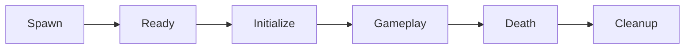

# Actor

> **Status:** In Progress
>
> **Last Updated:** 2026-11-06
>
> **Related:**
> - [overview.md](overview.md)
> - [components.md](components.md)
> - [state-machine.md](state-machine.md)
> - [resources.md](resources.md)
> - [combat-architecture.md](combat-architecture.md)
> - [ADR-002 — Composition over Inheritance](../adr/ADR-002%20%E2%80%94%20Composition%20over%20Inheritance.md)
> - [ADR-003 — Actor as the Base Gameplay Entity](../adr/ADR-003%20%E2%80%94%20Actor%20as%20the%20Base%20Gameplay%20Entity.md)

---

# Purpose

This document defines the **Actor** concept used throughout Project Echo.

Actor is the central gameplay abstraction of the project. Every active gameplay entity is represented by an Actor, and gameplay functionality is delegated to reusable components and states.

---

# Definition

An **Actor** is an active gameplay entity that:

- exists inside the game world;
- participates in gameplay;
- owns behaviour;
- coordinates reusable gameplay components;
- owns a State Machine;
- has a gameplay lifecycle.

An Actor is **not** a gameplay system. It is the object that brings gameplay systems together.

---

# Implemented Class

```gdscript
class_name Actor
extends CharacterBody2D

@export var data: ActorData

@onready var health: HealthComponent = $HealthComponent
@onready var hurtbox: HurtboxComponent = $HurtboxComponent
@onready var state_machine: StateMachine = $StateMachine
@onready var sprite: Sprite2D = get_node_or_null("Sprite2D")
@onready var weapon_component: WeaponComponent = get_node_or_null("WeaponComponent")
```

`Actor` requires:

- a `HealthComponent` child;
- a `HurtboxComponent` child;
- a `StateMachine` child.

`WeaponComponent` and `Sprite2D` are optional.

Implemented subclasses:

- `Player`;
- `Enemy` (with `Walker`, `Runner` and `Heavy` prototypes).

---

# Responsibilities

The Actor is responsible for:

- initializing `HealthComponent` from `ActorData.max_health`;
- connecting health and hurtbox signals;
- assigning itself to its state children;
- applying gravity;
- tracking coyote time and jump count;
- moving the `CharacterBody2D`;
- updating facing direction and sprite flip;
- exposing common actions such as `move`, `jump` and `attack`;
- applying knockback and entering the hurt/dead states when damaged.

It does not implement per-actor AI, attack timing or damage calculation.

---

# Out of Scope

Actor is **not** responsible for:

- calculating combat damage;
- attack phase timing;
- AI target detection;
- input handling;
- inventory or status effects;
- world generation;
- UI;
- save/load.

These belong to components, states or dedicated systems.

---

# Composition

## Player Scene

```text
Player (Actor)
├── Sprite2D
├── CollisionShape2D
├── HealthComponent
├── HurtboxComponent
│   └── CollisionShape2D
├── StateMachine
│   ├── Idle
│   ├── Move
│   ├── Fall
│   ├── Jump
│   ├── Attack
│   ├── Dead
│   ├── Hurt
│   └── JumpAttack
├── InputComponent
└── WeaponComponent
    └── HitboxComponent
        └── CollisionShape2D
```

## Enemy Scene

```text
Enemy (Actor)
├── Sprite2D
├── CollisionShape2D
├── HealthComponent
├── HurtboxComponent
│   └── CollisionShape2D
├── StateMachine
│   ├── Attack
│   ├── Dead
│   ├── Fall
│   ├── Idle
│   ├── Move
│   ├── Hurt
│   ├── Patrol
│   └── Chase
├── WeaponComponent
│   └── HitboxComponent
│       └── CollisionShape2D
└── DetectionComponent
```

Capabilities are defined by composition. The Actor class itself stays small.

There is no implemented `MovementComponent`. Movement is currently handled by `Actor` and by states.

---

# Configuration

Actor configuration is stored in `ActorData`:

```gdscript
class_name ActorData
extends Resource

@export var max_health: int = 5
@export var move_speed: float = 220.0
@export var jump_velocity: float = -420.0
@export var gravity: float = 1200.0
@export var coyote_time: float = 0.1
@export var max_jumps: int = 2
@export var jump_hold_force: float = 0.3
```

See [Resources](resources.md).

---

# Lifecycle



## Spawn

The Actor node enters the scene tree.

## Ready

`Actor._ready()`:

1. initializes `HealthComponent` with `data.max_health`;
2. connects `HealthComponent.died` and `HurtboxComponent.hit_received`;
3. assigns the Actor reference to each `State` child.

Subclasses override the state-machine setup:

- `Player` and `Enemy` call `initialize`, `setup_states` and `start("Idle")`.

## Gameplay

`_physics_process`:

1. updates coyote timer;
2. applies gravity when airborne;
3. runs `state_machine.physics_update`;
4. calls `move_and_slide`;
5. updates facing direction.

Subclasses may run `state_machine.update` from `_process`.

## Death

`HealthComponent.died` starts the `"Dead"` state. The current dead states call `Actor.die()`, which calls `queue_free()`.

## Cleanup

The Actor is removed from the scene tree.

---

# Public API

Movement and combat helpers:

```gdscript
func is_grounded() -> bool
func is_touching_wall() -> bool
func move(direction: float) -> void
func jump() -> void
func attack(type: AttackType.Type) -> void
func light_attack() -> void
func distance_to(other: Actor) -> float
func set_invulnerable(value: bool) -> void
func die() -> void
```

Damage handling:

```gdscript
func _on_hit_received(attack: AttackData) -> void
```

The flow is:

```text
HurtboxComponent.hit_received
        ↓
Actor._on_hit_received
        ↓
HealthComponent.take_damage(attack)
        ↓
apply knockback
        ↓
state_machine.start("Hurt")
```

If the damage kills the actor, `HealthComponent.died` starts `"Dead"` instead.

---

# Communication

Actor coordinates communication between its owned systems through:

- explicit public APIs;
- Godot signals;
- shared runtime data such as `AttackData`.

Components avoid direct dependencies on each other where practical.

---

# Dependency Rules

Components may depend on:

- their owning Actor;
- configuration Resources;
- stable public APIs.

Components should not depend on:

- specific Actor subclasses;
- the World;
- UI.

The current `DetectionComponent` is an exception: it detects `Player` specifically.

---

# Design Principles

## Identity vs Capability

Actor defines identity. Components define capability.

```text
Player           → what the object is
HealthComponent  → what it can do
WeaponComponent  → what it can do
```

## Lightweight Coordinator

The Actor coordinates systems rather than implementing large gameplay systems.

## Stable Public Interface

The Actor exposes a small API that components and states may safely use.

---

# Current Limitations

- There is no `MovementComponent`; movement lives in `Actor` and states.
- `ActorData.jump_hold_force` is declared but not used by the current actor implementation.
- Attack input, AI decisions and state transitions are implemented per subclass/state rather than by Actor.
- `Actor._setup_state_machine()` assigns state actors, but subclasses replace it with their own initialization.
- The `Player` scene includes a `JumpAttack` state, but its implementation refers to methods that do not exist on `Player`. Treat it as incomplete.

---

# Best Practices

- Keep the Actor lightweight.
- Delegate gameplay logic to components and states.
- Reuse components across multiple Actors.
- Prefer composition over subclassing.
- Keep initialization explicit.
- Maintain explicit ownership.

---

# Anti-Patterns

Avoid:

- large gameplay methods inside Actor;
- actor-specific implementations of reusable systems;
- components referencing concrete subclasses;
- business logic inside lifecycle methods;
- turning Actor into a "God Object".

---

# Related Documents

- [Architecture Overview](overview.md)
- [Components](components.md)
- [State Machine](state-machine.md)
- [Resources](resources.md)
- [Combat Architecture](combat-architecture.md)
- [ADR-002 — Composition over Inheritance](../adr/ADR-002%20%E2%80%94%20Composition%20over%20Inheritance.md)
- [ADR-003 — Actor as the Base Gameplay Entity](../adr/ADR-003%20%E2%80%94%20Actor%20as%20the%20Base%20Gameplay%20Entity.md)
