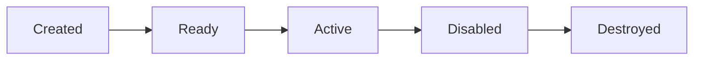

# Components

> **Status:** In Progress
>
> **Last Updated:** 2026-11-06
>
> **Related:**
> - [overview.md](overview.md)
> - [actor.md](actor.md)
> - [state-machine.md](state-machine.md)
> - [resources.md](resources.md)
> - [combat-architecture.md](combat-architecture.md)
> - [ADR-002 — Composition over Inheritance](../adr/ADR-002%20%E2%80%94%20Composition%20over%20Inheritance.md)
> - [ADR-003 — Actor as the Base Gameplay Entity](../adr/ADR-003%20%E2%80%94%20Actor%20as%20the%20Base%20Gameplay%20Entity.md)

---

# Purpose

This document describes the component architecture used in Project Echo.

Components are the primary building blocks of gameplay functionality. Rather than implementing gameplay logic inside Actors, gameplay behaviour is assembled by composing Actors from independent components.

---

# Definition

A **Component** is a reusable gameplay module that provides a single capability to its owning Actor.

A component:

- owns one gameplay responsibility;
- manages its own internal state;
- exposes a clear public API;
- collaborates through stable interfaces.

A component does not define the identity of an Actor.

---

# Implemented Components

| Component | Extends | Responsibility |
|-----------|---------|----------------|
| `HealthComponent` | `Node` | Health, damage, healing, death signal |
| `WeaponComponent` | `Node2D` | Attack selection, timing, hitbox activation |
| `HitboxComponent` | `Area2D` | Offensive collision detection |
| `HurtboxComponent` | `Area2D` | Defensive hit reception |
| `DetectionComponent` | `Area2D` | Detects the `Player` and reports target position |
| `InputComponent` | `Node` | Reads player input into an `InputCommand` |

Planned but not implemented:

- `MovementComponent`
- `InteractionComponent`
- `DialogueComponent`
- `StatusEffectComponent`
- `InventoryComponent`

---

# Ownership

Every component belongs to exactly one Actor (or to the Actor's weapon node, for hitboxes).

```text
Actor
├── HealthComponent
├── HurtboxComponent
├── WeaponComponent
│   └── HitboxComponent
├── DetectionComponent   (enemy only)
└── InputComponent       (player only)
```

`Actor` requires `HealthComponent`, `HurtboxComponent` and `StateMachine`. It looks up `WeaponComponent` optionally.

---

# Communication

Components communicate through:

- public methods;
- Godot signals;
- shared runtime data such as `AttackData`.

Components avoid direct knowledge of each other where practical. The Actor coordinates the damage reaction.

---

# HealthComponent

```gdscript
class_name HealthComponent
extends Node
```

Responsibilities:

- store `current_health` and `max_health`;
- initialize health from `ActorData.max_health`;
- apply damage from `AttackData`;
- heal;
- clamp values;
- emit `health_changed`, `damaged`, `healed` and `died`.

Public API:

```gdscript
func initialize(max_hp: int) -> void
func take_damage(attack_data: AttackData) -> void
func heal(amount: int) -> void
func set_max_health(value: int) -> void
func is_alive() -> bool
func get_health_percentage() -> float
```

It does not animate, apply knockback or decide state transitions.

---

# WeaponComponent

```gdscript
class_name WeaponComponent
extends Node2D
```

Responsibilities:

- own a `WeaponData` resource;
- select an `AttackDefinition` for an `AttackType`;
- create one `AttackData` per attack;
- run the attack phases `IDLE → STARTUP → ACTIVE → RECOVERY`;
- position and activate its `HitboxComponent`;
- emit `attack_started` / `attack_finished`.

Public API:

```gdscript
func can_attack() -> bool
func is_attacking() -> bool
func start_attack(type: AttackType.Type) -> void
func interrupt_attack() -> void
```

The component does not apply damage. `AttackData` is created immediately when the attack starts, before the active phase.

---

# HitboxComponent

```gdscript
class_name HitboxComponent
extends Area2D
```

Responsibilities:

- start disabled (`monitoring = false`);
- activate with an `AttackData` payload;
- detect overlapping `HurtboxComponent` areas;
- ignore its own Actor;
- prevent duplicate hits on the same target during one activation;
- forward the payload through `HurtboxComponent.receive_hit`.

It never calculates or applies damage.

---

# HurtboxComponent

```gdscript
class_name HurtboxComponent
extends Area2D
```

Responsibilities:

- receive incoming `AttackData`;
- block hits while invulnerable;
- emit `hit_received` when a hit is accepted;
- emit `damage_blocked` when invulnerable.

Public API:

```gdscript
func can_receive_hit() -> bool
func set_invulnerable(value: bool) -> void
func receive_hit(attack: AttackData) -> void
```

It does not apply damage, knockback or death logic. The owning `Actor` does that.

---

# DetectionComponent

```gdscript
class_name DetectionComponent
extends Area2D
```

Responsibilities:

- detect a `Player` hurtbox entering its area;
- remember the detected player;
- expose `get_target_position()`;
- emit `player_detected` and `player_lost`.

The component currently detects only `Player`. It is not a general perception system.

---

# InputComponent

```gdscript
class_name InputComponent
extends Node
```

Responsibilities:

- read the movement axis and apply a deadzone;
- append `Command` objects for jump, attack, dash and interact;
- expose the current `InputCommand`;
- enable or disable input processing.

The command buffer time constant (`INPUT_BUFFER_TIME`) is declared but not yet used for expiry.

---

# Lifecycle

Components follow the lifecycle of their owning Actor:



- **Created** — instantiated as part of the Actor scene.
- **Ready** — references and configuration are initialized.
- **Active** — participates in gameplay.
- **Disabled** — temporarily stops affecting gameplay (for example, a deactivated hitbox).
- **Destroyed** — removed together with the Actor.

---

# Design Principles

## Single Responsibility

Each component owns one gameplay concern.

## Reusability

A component should work with any compatible Actor. `HealthComponent`, `HitboxComponent` and `HurtboxComponent` are already shared by player and enemies.

## Encapsulation

A component owns its internal state. Other systems interact through its public API.

## Data-Driven Configuration

Configuration belongs in Resources. `WeaponComponent` receives `WeaponData`, not hardcoded attacks.

---

# Current Limitations

- There is no generic `MovementComponent`.
- `DetectionComponent` is hardcoded to `Player`.
- `HitboxComponent` finds its Actor by walking up the node tree.
- Attack duplicate prevention is per activation; there is no global hit cooldown.
- `HurtboxComponent` invulnerability is a simple boolean with no timer; timers are managed by states.

---

# Best Practices

- One responsibility per component.
- Expose a clean public API.
- Keep components reusable.
- Use Resources for configuration.
- Keep communication explicit.

---

# Anti-Patterns

Avoid:

- components depending on concrete Actor subclasses;
- components creating other components outside their ownership;
- components directly controlling the world;
- manager components that know too much;
- circular dependencies.

---

# Related Documents

- [Architecture Overview](overview.md)
- [Actor](actor.md)
- [State Machine](state-machine.md)
- [Resources](resources.md)
- [Combat Architecture](combat-architecture.md)
