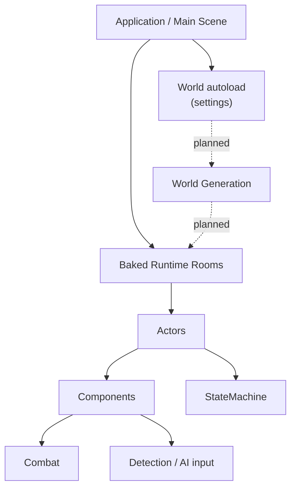
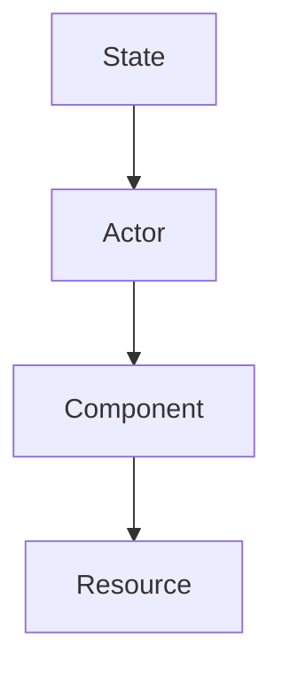

# Architecture Overview

> **Status:** In Progress
>
> **Last Updated:** 2026-11-06
>
> **Related:**
> - [project-structure.md](project-structure.md)
> - [actor.md](actor.md)
> - [components.md](components.md)
> - [state-machine.md](state-machine.md)
> - [resources.md](resources.md)
> - [combat-architecture.md](combat-architecture.md)
> - [ai-architecture.md](ai-architecture.md)
> - [glossary.md](glossary.md)
> - [../world/overview.md](../world/overview.md)

---

# Purpose

This document provides a high-level overview of the Project Echo architecture.

It describes the major building blocks of the project, their responsibilities and the relationships between them. Detailed implementation belongs in the dedicated documents linked above.

Project Echo is an early prototype built around a long-term architecture. Some systems are implemented, some are partially wired, and some are planned. This overview says which is which instead of describing the target design as if it were complete.

---

# Architectural Goals

Project Echo is designed around the following goals:

- build reusable gameplay systems;
- minimize coupling between systems;
- separate gameplay logic from configuration;
- prefer composition over inheritance;
- keep systems data-driven whenever possible;
- design for long-term maintainability rather than short-term convenience.

---

# High-Level Architecture



The current runtime is assembled from:

- a main scene;
- baked runtime room scenes;
- `Actor`-derived gameplay entities;
- reusable components;
- per-actor state machines.

World generation is planned and does not exist yet.

---

# Core Building Blocks

## Application

The application root is the scene configured in `project.godot`.

It is currently a prototype test scene, not a finished game shell. There is no implemented save/load manager, global game state or menu flow.

---

## World

`World` is an autoload that exposes `WorldSettings`:

```gdscript
var settings: WorldSettings
```

`WorldSettings` currently contains only `tile_size`.

The broader responsibilities often associated with a "World" system —

- biome generation;
- room placement;
- room streaming;
- world progression;
- player traversal between rooms —

are **planned** and are not implemented in the `World` autoload.

See [World Architecture](../world/overview.md).

---

## Room

A room is the smallest self-contained gameplay area.

A room has three representations:

1. authored brush scene;
2. baked `RoomData` and generated runtime scene;
3. instantiated runtime room.

Rooms are authored with semantic brushes, baked in advance and reused by future world generation.

See [Room Architecture](../world/room-architecture.md).

---

## Actor

Actors are the active gameplay entities.

Implemented:

- `Actor` — base class extending `CharacterBody2D`;
- `Player`;
- `Enemy` and the `Walker`, `Runner` and `Heavy` prototypes.

An Actor owns components, a state machine and an optional `ActorData` resource. It coordinates gameplay but delegates mechanics to components and states.

See [Actor](actor.md).

---

## Components

Gameplay functionality is implemented through components.

Implemented:

- `HealthComponent`
- `WeaponComponent`
- `HitboxComponent`
- `HurtboxComponent`
- `DetectionComponent`
- `InputComponent`

`Actor` requires `HealthComponent`, `HurtboxComponent` and `StateMachine`. `WeaponComponent` is optional and is looked up by node name.

See [Components](components.md).

---

## State Machine

Each Actor owns a `StateMachine` node containing `State` children.

Implemented state sets:

**Player**

- `Idle`
- `Move`
- `Fall`
- `Jump`
- `JumpAttack`
- `Attack`
- `Hurt`
- `Dead`

**Enemy**

- `Idle`
- `Patrol`
- `Chase`
- `Attack`
- `Hurt`
- `Dead`
- `Fall`
- `Move`

The state machine supports enter/exit, update, physics update, input handling and attack-finished callbacks.

See [State Machine](state-machine.md).

---

## Resources

Configuration and baked data are stored in Godot `Resource` types.

Implemented examples:

- `ActorData`
- `WeaponData`
- `AttackDefinition`
- `RoomData`
- `ThemeInfo`
- `WorldSettings`

See [Resources](resources.md) and [Resources Catalog](resources-catalog.md).

---

# Gameplay Systems

## Combat

Combat is component-driven:

```text
WeaponComponent → HitboxComponent → HurtboxComponent → Actor → HealthComponent
```

`WeaponComponent` owns attack timing phases and creates `AttackData`. `HitboxComponent` forwards it to a target `HurtboxComponent`, which emits `hit_received`. The target `Actor` applies damage through `HealthComponent`, applies knockback and transitions to `Hurt` or `Dead`.

See [Combat Architecture](combat-architecture.md).

## AI

Enemy behaviour is state-machine-driven. `DetectionComponent` detects the `Player` and emits signals.

`Walker`, `Runner` and `Heavy` connect detection signals to state changes. The base `Enemy` defines the signal wiring but its detection callbacks are empty, so detection-to-behaviour wiring is incomplete for that base class.

See [AI Architecture](ai-architecture.md).

## Other Systems

Not implemented:

- status effects;
- inventory;
- progression;
- interaction;
- dialogue;
- quests.

---

# Communication

Project Echo uses explicit communication:

- Godot signals;
- explicit node references;
- stable public APIs;
- shared runtime data objects such as `AttackData`.

Components avoid depending on concrete Actor subclasses where practical. `DetectionComponent` is currently an exception: it explicitly detects `Player`.

---

# Dependency Rules

Dependencies should point downward:



Lower-level systems should not depend on higher-level systems.

Current examples:

- `HealthComponent` knows nothing about `Player`.
- `WeaponComponent` knows nothing about enemy AI.
- `Actor` coordinates components without implementing their mechanics.

---

# Design Principles

## Composition over Inheritance

Gameplay behaviour is assembled through components and states rather than deep inheritance trees.

## Data-Driven Design

Configuration belongs in Resources. Logic belongs in code.

## Single Responsibility

Each system should solve one problem.

## Explicit Ownership

- a room owns its runtime nodes;
- an Actor owns its components and state machine;
- components own their internal state.

## Reusability

Components should work for any compatible Actor.

---

# Architecture Boundaries

This document intentionally does not describe:

- individual mechanics in detail;
- combat implementation details;
- world generation algorithms;
- AI behaviour details;
- the theme pipeline;
- save/load;
- UI.

Each topic has a dedicated document.

---

# Documentation Philosophy

Architecture documentation is part of the project.

When implementation changes an architectural decision:

1. update or supersede the relevant documentation;
2. do not preserve a third interpretation;
3. keep ADRs as historical records.

---

# Related Documents

- [Project Structure](project-structure.md)
- [Actor](actor.md)
- [Components](components.md)
- [State Machine](state-machine.md)
- [Combat Architecture](combat-architecture.md)
- [AI Architecture](ai-architecture.md)
- [Resources](resources.md)
- [Glossary](glossary.md)
- [World Architecture](../world/overview.md)
