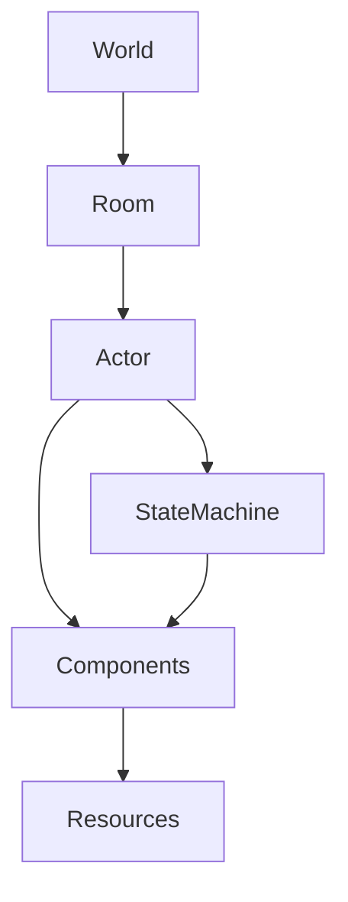

# Project Structure

> **Status:** Stable
>
> **Last Updated:** 2026-11-06
>
> **Related:**
> - [overview.md](overview.md)
> - [resources.md](resources.md)
> - [world/overview.md](../world/overview.md)
> - [ADR-001 — Layer-Based Project Structure](../adr/ADR-001%20%E2%80%94%20Layer-Based%20Project%20Structure.md)

---

# Purpose

This document defines the directory layout of Project Echo.

The project is organized by **architectural responsibility**, not by gameplay feature. Related systems live together even when they are used by different actors or rooms.

---

# Design Principles

- Group files by responsibility.
- Keep runtime, authoring and debug code distinguishable.
- Separate code from content and configuration.
- Keep project-specific code out of `addons/`.
- Prefer explicit organization over deep nesting.
- Avoid generic folders such as `misc/` or `utils/`.

---

# Root Directory

```text
project-echo/
│
├── addons/
├── assets/
├── autoload/
├── docs/
├── resources/
├── scenes/
├── scripts/
├── test/
├── project.godot
├── plug.gd
└── .gitignore
```

Generated directories such as `.plugged/` and `reports/` are intentionally not part of the source layout.

---

# Root Folder Responsibilities

## `addons/`

Third-party Godot addons.

Addons are managed with **gd-plug**:

- dependency declarations live in `plug.gd`;
- `addons/gd-plug/` is the tracked bootstrap;
- other managed addon files are generated/installed artifacts;
- project-specific code must never be placed in `addons/`.

The currently enabled editor plugins are configured in `project.godot` under `[editor_plugins]`.

---

## `assets/`

Source assets used by the game.

Current examples:

```text
assets/
│
├── aseprite/
├── sprites/
│   ├── acrots/
│   ├── themes/
│   └── tiles/
```

Theme assets under `assets/sprites/themes/<theme>/` are the source of built theme resources. A theme directory contains:

- `<theme>.json` — Aseprite slice metadata;
- one PNG per slice name, for example `platform_full_01.png`.

Do not manually edit built resources under `resources/themes/` when the theme pipeline can regenerate them.

---

## `autoload/`

Godot singleton services.

Current autoloads:

| Autoload | Source | Responsibility |
|----------|--------|----------------|
| `input_setup` | `scripts/core/input/input_setup.gd` | Registers keyboard and gamepad input actions at startup |
| `World` | `autoload/world.gd` | Exposes global world settings (`World.settings`) |

Autoloads provide global services. Gameplay mechanics should not be implemented here.

---

## `docs/`

Technical documentation. See [README.md](../README.md).

---

## `resources/`

Godot `Resource` assets.

Current layout:

```text
resources/
│
├── actors/
│   ├── actor_data.tres
│   ├── player/
│   └── enemy/
│       ├── walker/
│       ├── runner/
│       └── heavy/
│
├── themes/
│   └── default/
│       ├── default_theme.tres
│       ├── default_tile_assets.tres
│       └── default_tileset.tres
│
└── world/
    ├── world_settings.gd
    └── world_settings.tres
```

Resources describe configuration and baked data. They do not contain runtime behaviour.

Planned data such as room databases or biome definitions does not yet have an implemented layout.

---

## `scenes/`

Godot scenes.

Current layout:

```text
scenes/
│
├── actors/
│   ├── actor.tscn
│   ├── player/player.tscn
│   └── enemy/
│       ├── walker.tscn
│       ├── runner.tscn
│       └── heavy.tscn
│
├── camera_rig.tscn
├── rooms/
│   ├── <room_name>/
│   │   ├── <room_name>_room_data.tres
│   │   └── <room_name>_runtime.tscn
│   └── ...
│
└── test_scene.tscn
```

`scenes/rooms/` contains generated bake output. The authored room scene remains the source of truth.

---

## `scripts/`

GDScript implementation.

Current organization:

```text
scripts/
│
├── actors/
│   ├── player/
│   └── enemy/
│       ├── walker/
│       ├── runner/
│       └── heavy/
│
├── core/
│   ├── actor/
│   ├── camera/
│   ├── components/
│   └── input/
│
├── state_machine/
│   ├── states/
│   │   ├── player_state/
│   │   └── enemy_state/
│   ├── state.gd
│   └── state_machine.gd
│
├── theme/
│   ├── build_step/
│   ├── debug/
│   └── ...
│
└── world/
    ├── authoring/
    │   ├── brushes/
    │   └── collection/
    ├── bake/
    │   ├── bake_processor/
    │   ├── bake_step/
    │   ├── bake_validator/
    │   ├── post_bake_processor/
    │   └── semantic_data/
    ├── debug/
    ├── semantic/
    └── test/
```

Script folders follow the same responsibility split as the architecture:

- `core/` — shared actor, component and input foundations;
- `actors/` — concrete actor variants;
- `state_machine/` — state implementations and state-machine infrastructure;
- `world/` — authoring, semantic data, baking and runtime room construction;
- `theme/` — theme build and application pipeline.

---

## `test/`

Automated tests using **GdUnit4**.

```text
test/
│
├── fixtures/
├── integration/
│   ├── actors/
│   └── bake/
└── unit/
    ├── actors/
    ├── bake/
    ├── brush/
    ├── room/
    ├── semantic/
    ├── theme/
    └── topology/
```

Tests are the strongest available verification for gameplay and world systems. `reports/` is generated output and is not part of the source layout.

---

# Runtime, Authoring and Debug Code

The project distinguishes three concerns:

| Concern | Examples | Rule |
|---------|----------|------|
| Runtime | actors, components, runtime room construction, theme application | Must not depend on editor-only or authoring-only functionality |
| Authoring | semantic brushes, brush collection, bake steps/processors | May depend on runtime data types, but must not perform gameplay |
| Debug | `scripts/world/debug/`, `scripts/theme/debug/` | Developer tooling; not part of the runtime contract |

Authoring objects such as `SemanticBrush` are `@tool` nodes because they draw editor previews. They describe authoring intent and must not bake or construct runtime content themselves.

---

# Naming Conventions

## Folders and files

Use `snake_case`:

```text
state_machine/
health_component.gd
player_attack_definition.tres
```

## Classes

Use `PascalCase` with `class_name`:

```gdscript
class_name HealthComponent
class_name SemanticBrush
class_name BakePipeline
```

The script file name should match the primary class in `snake_case`:

```text
health_component.gd -> HealthComponent
semantic_brush.gd   -> SemanticBrush
```

## Scenes

Use `snake_case` file names:

```text
player.tscn
walker.tscn
test_scene_for_bake.tscn
```

Debug scenes use a `_debug.tscn` suffix.

## Signals and methods

Use `snake_case` for methods and signals, and `PascalCase` for enum types where the project already does so:

```gdscript
signal hit_received(attack: AttackData)

enum AttackPhase { IDLE, STARTUP, ACTIVE, RECOVERY }
```

Consistency with the surrounding code is more important than introducing a new style.

---

# Dependency Rules

Dependencies point from higher-level coordination toward lower-level capabilities:



Examples:

- `HealthComponent` does not know about `Player`.
- `WeaponComponent` does not know about enemy AI.
- Components do not depend on the world system.
- Authoring brushes do not depend on the bake pipeline.
- Theme application does not mutate room topology.

---

# Best Practices

- Put reusable code in `scripts/core/`.
- Keep concrete actor variants in `scripts/actors/`.
- Keep world authoring, baking and runtime construction separated under `scripts/world/`.
- Keep theme building and theme application separated under `scripts/theme/`.
- Store configuration and baked data in `resources/`.
- Regenerate baked assets from their source instead of editing them by hand.
- Add tests under `test/unit/` or `test/integration/`.

---

# Anti-Patterns

Avoid:

- placing project code in `addons/`;
- mixing authoring, baking and runtime responsibilities in one class;
- storing gameplay state inside Resources;
- editing generated theme or room artifacts directly;
- creating catch-all folders or scripts;
- introducing a second source of truth for generated content.

---

# Related Documentation

- [Architecture Overview](overview.md)
- [Resources](resources.md)
- [World Architecture Overview](../world/overview.md)
- [ADR-001 — Layer-Based Project Structure](../adr/ADR-001%20%E2%80%94%20Layer-Based%20Project%20Structure.md)
