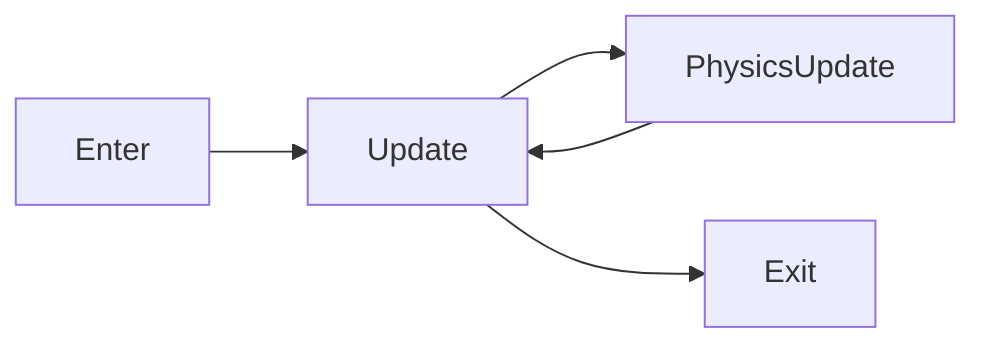

# State Machine

> **Status:** In Progress
>
> **Last Updated:** 2026-11-06
>
> **Related:**
> - [overview.md](overview.md)
> - [actor.md](actor.md)
> - [components.md](components.md)
> - [combat-architecture.md](combat-architecture.md)
> - [ai-architecture.md](ai-architecture.md)

---

# Purpose

This document describes the state machine architecture used by gameplay Actors in Project Echo.

The state machine coordinates Actor behaviour by determining **what the Actor is currently doing**. It does not implement gameplay mechanics; it orchestrates components and actor APIs to produce behaviour.

---

# Definition

A **State Machine** controls the execution flow of an Actor. It determines:

- which State is active;
- when transitions occur;
- which components the active State uses.

Gameplay behaviour emerges from the collaboration between States and components.

---

# Implemented Classes

## StateMachine

```gdscript
class_name StateMachine
extends Node

var states: Dictionary = {}
var actor: Actor
var current_state: State
var previous_state: State
```

Public API:

```gdscript
func initialize(owner: Actor) -> void
func setup_states() -> void
func start(initial_state_name: StringName) -> void
func update(delta: float) -> void
func physics_update(delta: float) -> void
func handle_input(event: InputEvent) -> void
func handle_attack_finished(attack: AttackDefinition) -> void
func change_state(new_state_name: StringName) -> void
```

States are registered by child node name. `change_state` validates the target name, exits the current State and enters the new one. Changing to the already-active State is ignored.

## State

```gdscript
class_name State
extends Node

var actor: Actor
var state_machine: StateMachine
```

Overridable hooks:

```gdscript
func enter() -> void
func exit() -> void
func update(delta: float) -> void
func physics_update(delta: float) -> void
func handle_input(event: InputEvent) -> void
func on_attack_finished(attack: AttackDefinition) -> void
```

`change_state(name)` forwards to the state machine.

---

# Ownership

Each Actor owns exactly one `StateMachine` node. States are children of that node.

```text
Actor
├── StateMachine
│   ├── Idle
│   ├── Move
│   ├── ...
│   └── Dead
├── HealthComponent
├── HurtboxComponent
└── WeaponComponent
```

`Actor._ready()` assigns itself to every `State` child. `Player` and `Enemy` then call `state_machine.initialize(self)` and `setup_states()`, which lets subclass states such as `PlayerState` and `EnemyState` resolve their typed actor references.

---

# State Lifecycle



- **Enter** — once when the State becomes active.
- **Update** — every frame, driven by `Actor` subclasses through `_process`.
- **Physics Update** — during the physics step, driven by `Actor._physics_process`.
- **Input** — forwarded through `handle_input` when used.
- **Exit** — once before leaving the State.

Not every State overrides every hook.

---

# Implemented States

## Player

| State | Behaviour |
|-------|-----------|
| `Idle` | Waits; transitions on movement, jump, attack or falling |
| `Move` | Moves horizontally from input |
| `Jump` | Applies jump velocity |
| `Fall` | Applies air movement and landing transitions |
| `Attack` | Locks input, starts a light attack, returns on `attack_finished` |
| `JumpAttack` | Incomplete; calls methods that do not exist on `Player` |
| `Hurt` | Locks input, enables invulnerability, returns after recovery |
| `Dead` | Calls `Actor.die()` |

## Enemy

| State | Behaviour |
|-------|-----------|
| `Idle` | Waits for patrol/chase conditions |
| `Patrol` | Moves back and forth within `patrol_distance` |
| `Chase` | Moves toward the detected player; attacks in range |
| `Move` | Basic movement state |
| `Fall` | Airborne state |
| `Attack` | Starts a light attack and transitions on finish |
| `Hurt` | Enables invulnerability, returns after recovery |
| `Dead` | Calls `Actor.die()` |

`PlayerState` and `EnemyState` provide shared helpers and global transitions (death, jump, attack, dash for player).

---

# Components Interaction

States coordinate components; they do not reimplement them.

```text
PlayerAttackState.enter()
        ↓
Player.attack(LIGHT)
        ↓
WeaponComponent.start_attack()
        ↓
HitboxComponent.activate()
```

`WeaponComponent` emits `attack_finished`, which the Actor forwards to `state_machine.handle_attack_finished`. The active State decides the next state.

---

# Transition Rules

Transitions should be:

- explicit;
- deterministic;
- easy to follow.

A State should not silently transition to multiple destinations.

Example player flow:

```text
Idle ↔ Move
  ↓
Jump → Fall → Idle/Move
  ↓
Attack → Idle/Move/Fall
  ↓
Hurt → Idle/Move/Fall
  ↓
Dead
```

---

# Communication

States may communicate with:

- their owning Actor;
- components reached through the Actor;
- `InputComponent` (player states);
- `DetectionComponent` indirectly through `Enemy.get_target_position()`.

States should avoid direct communication with unrelated Actors, UI or world systems.

---

# State Categories

## Locomotion

- Idle
- Move
- Jump
- Fall
- Dash (referenced by `PlayerState`, but no state or scene exists)

## Combat

- Attack
- JumpAttack (incomplete)
- Hurt
- Dead

## AI

- Patrol
- Chase

---

# Design Principles

## One State — One Intent

Each State represents one clear gameplay intention.

## Components Perform Work

States coordinate. Components execute.

## Explicit Transitions

Transition conditions should be visible rather than hidden behind unrelated flags.

## Predictable Flow

State flow should be easy to visualize and debug.

---

# Current Limitations

- `PlayerState` attempts `change_state("Dash")`, but no `Dash` state node or script exists.
- `PlayerJumpAttackState` calls `player.start_air_attack()` and `player.is_attack_finished()`, which are not implemented on `Player`. The state should be treated as incomplete.
- Enemy `has_movement_input()` always returns `false`, so some shared transitions are placeholders.
- The base `Enemy` starts in `Idle` and does not itself move to `Patrol` or `Chase`; prototype subclasses supply that behaviour.
- Input is polled through `InputComponent`; `StateMachine.handle_input` exists but is not the main input path.

---

# Best Practices

- Keep States lightweight.
- Delegate gameplay logic to components.
- Use `enter`/`exit` for temporary changes.
- Make transitions explicit.
- Keep responsibilities focused.

---

# Anti-Patterns

Avoid:

- large gameplay systems inside States;
- direct damage calculations;
- hardcoded references to specific Actors;
- state-specific implementations of reusable mechanics;
- circular transition logic.

---

# Related Documents

- [Architecture Overview](overview.md)
- [Actor](actor.md)
- [Components](components.md)
- [Combat Architecture](combat-architecture.md)
- [AI Architecture](ai-architecture.md)
