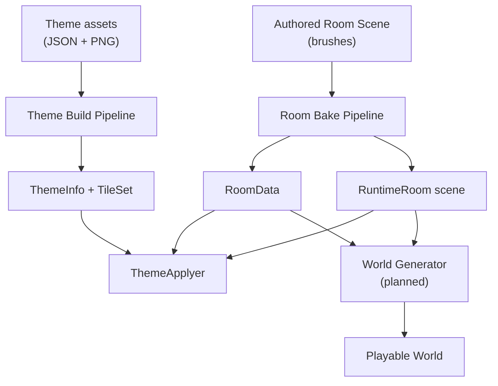

# World Architecture Overview

> **Status:** In Progress
>
> **Last Updated:** 2026-11-06
>
> **Related:**
> - [room-architecture.md](room-architecture.md)
> - [room-data.md](room-data.md)
> - [semantic-tiles.md](semantic-tiles.md)
> - [world-authoring.md](world-authoring.md)
> - [bake-pipeline.md](bake-pipeline.md)
> - [themes.md](themes.md)
> - [world-generation.md](world-generation.md)

---

# Purpose

This document describes the high-level architecture of the world system in Project Echo.

The target model is a procedurally assembled world built from handcrafted, reusable rooms. The current implementation covers authoring, semantic data, baking, runtime room construction and theming. World assembly itself is still planned.

---

# Design Goals

The world system should provide:

- handcrafted gameplay quality;
- procedural replayability;
- reusable room assets;
- data-driven generation;
- visual themes that can change without changing gameplay topology;
- future biome and streaming support.

---

# High-Level Architecture



Two pipelines intentionally remain separate:

- the **room bake pipeline** produces semantic/runtime room data;
- the **theme build pipeline** produces visual theme data.

A theme must not change room topology, and baking must not depend on a particular biome theme.

---

# Core Concepts

## World

The complete playable game world.

Planned responsibilities:

- biome selection;
- room graph generation;
- room loading;
- world progression.

The world does not control gameplay inside individual actors.

---

## Biome

A collection of compatible rooms and generation rules.

Planned responsibilities:

- visual theme selection;
- enemy pools;
- music;
- generation constraints;
- progression rules.

Biome data is not implemented yet.

---

## Room

The smallest generation unit.

A room is a handcrafted gameplay space, authored with semantic brushes. It is baked into reusable runtime data rather than generated from raw tiles during gameplay.

A room has three distinct representations:

1. **authored room scene** — brush-based authoring data;
2. **baked room data** — `RoomData` plus a generated runtime scene;
3. **runtime room** — the instantiated scene used during gameplay.

See [room-architecture.md](room-architecture.md).

---

## Semantic Authoring

Semantic data describes gameplay meaning independently from visuals.

Current semantic spatial types:

```text
PLATFORM
WALL
BACKGROUND
```

Marker and volume layers exist in the data model but are not yet authored or baked.

See [semantic-tiles.md](semantic-tiles.md).

---

## Bake

Bake converts authored brush data into validated runtime data.

Default pipeline:

```text
CollectBrushesStep
→ InitSemanticDataStep
→ BakeSemanticLayerStep
→ PostProcessStep
→ ValidateStep
→ BuildRuntimeRoomStep
→ ApplyDefaultThemeStep
→ SaveRoomDataStep
```

See [bake-pipeline.md](bake-pipeline.md).

---

## Theme

A theme maps semantic cells to visual tiles.

Current theme assets are authored as Aseprite slice metadata plus one PNG per slice. The theme build pipeline produces a TileSet and `ThemeInfo`. `ThemeApplyer` maps background, platform and wall cells onto a `TileMapLayer`.

Themes are separate from room topology and from world generation.

See [themes.md](themes.md).

---

# Current Scope

Implemented:

- brush-based room authoring;
- semantic spatial layers and cells;
- topology computation;
- bake pipeline with validation;
- `RoomData` generation;
- generated runtime room scene;
- default theme build and application;
- `ConnectionData` data type.

Partially implemented or not yet wired:

- marker and volume authoring/baking;
- room connection authoring and validation;
- enemy spawning from markers;
- theme selection by biome.

Not yet implemented:

- room database;
- biome generation;
- room graph generation;
- world assembly;
- world streaming.

---

# Related Documents

- [Room Architecture](room-architecture.md)
- [Room Data](room-data.md)
- [Semantic Tiles](semantic-tiles.md)
- [World Authoring](world-authoring.md)
- [Bake Pipeline](bake-pipeline.md)
- [Themes](themes.md)
- [Connection Points](connection-points.md)
- [World Generation](world-generation.md)
