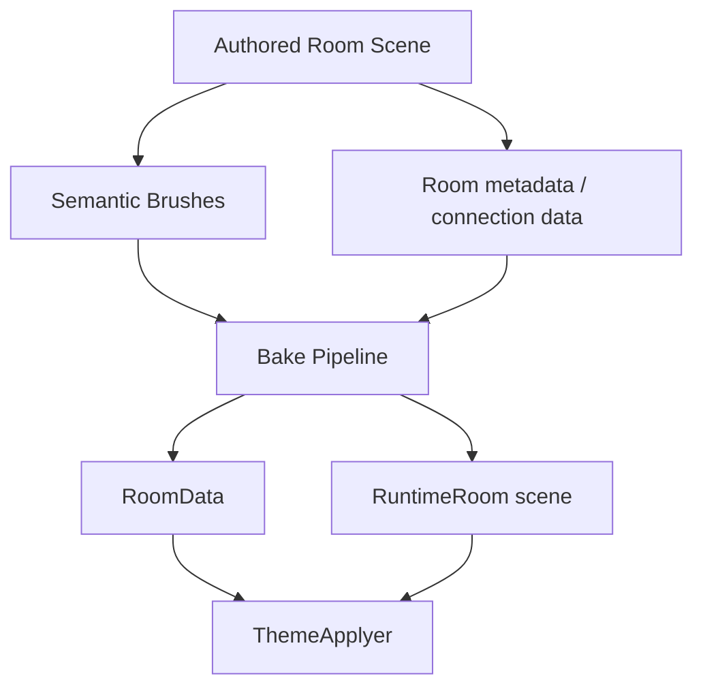
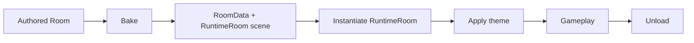

# Room Architecture

> **Status:** In Progress
>
> **Last Updated:** 2026-11-06
>
> **Related:**
> - [overview.md](overview.md)
> - [room-data.md](room-data.md)
> - [semantic-tiles.md](semantic-tiles.md)
> - [bake-pipeline.md](bake-pipeline.md)
> - [themes.md](themes.md)

---

# Purpose

A room is the fundamental gameplay building block of Project Echo.

Instead of generating gameplay from individual tiles during runtime, the game assembles worlds from rooms that were authored and baked in advance.

---

# Room Representations

A room is not a single object. It has three separate representations with different responsibilities.

## 1. Authored Room Scene

The authored scene is the designer-facing source of truth. It contains:

- semantic brushes for platforms, walls and background;
- authoring-only nodes;
- editor visualization.

Semantic brushes are `@tool` nodes. They describe intent and draw editor previews, but they do not bake rooms or construct runtime content.

## 2. Baked Room Data

The bake pipeline converts authored data into:

- `RoomData` — a `Resource` containing validated semantic cells;
- a generated runtime room scene;
- an optional theme applied to that scene.

Baked output is stored under `scenes/rooms/<room_name>/`.

## 3. Runtime Room

The generated runtime scene is instantiated during gameplay.

Current structure:

```text
RuntimeRoom (Node2D)
└── Semantic (Node2D)
    └── Tiles (TileMapLayer)
```

`RuntimeRoomBuilder` creates only this structure. It does not create tiles.

`ThemeApplyer` finds `Semantic/Tiles` and populates it using `ThemeInfo` and `RoomData`.

---

# Responsibilities

A room is responsible for containing, in its authored or baked form:

- geometry;
- gameplay layout;
- semantic information;
- connection data;
- metadata required by generation.

A room is **not** responsible for:

- procedural world generation;
- selecting its biome;
- choosing its visual theme;
- runtime gameplay state.

---

# Room Composition



---

# Runtime Lifecycle



Runtime does not repeat the bake process.

---

# Authoring Boundaries

## Brushes

Brushes are authoring objects. They:

- have a grid position and size;
- know their brush type;
- may carry traits such as `ONE_WAY` or `BREAKABLE`;
- are collected recursively from the room scene.

Brushes do not:

- perform bake operations;
- know about bake steps or processors;
- construct `TileMap` content;
- apply themes.

## Bake Steps

Bake steps transform data:

- collect brushes;
- initialize semantic data;
- run processors;
- compute topology;
- validate;
- build `RoomData` and the runtime scene;
- apply the default theme;
- save the output.

## Runtime

Runtime is responsible for:

- instantiating baked runtime rooms;
- assembling the world;
- running gameplay.

---

# Visual Representation

Visual representation is applied by themes, not by room authoring.

A room can be reused with different themes as long as its semantic layout remains compatible.

Examples:

```text
Semantic platform
→ default theme
→ platform tiles
```

```text
Semantic platform
→ forest theme (planned)
→ grass/wood platform tiles
```

A theme must not change collision topology or gameplay semantics.

---

# Design Philosophy

Rooms are authored once and reused many times.

The procedural generator assembles rooms instead of constructing geometry from scratch.

This provides:

- predictable gameplay;
- better runtime performance;
- designer control;
- easier balancing;
- visual variety through themes.

---

# Current Limitations

- The room database and world generator are not implemented.
- Connections are represented by `ConnectionData`, but no authoring or bake path populates `RoomData.connections` yet.
- Marker and volume layers are not baked.
- Runtime room construction currently creates a single `TileMapLayer` named `Tiles`.
- The default theme is applied during bake; biome-driven theme selection is planned.

---

# Related Documents

- [World Overview](overview.md)
- [Room Data](room-data.md)
- [Semantic Tiles](semantic-tiles.md)
- [Bake Pipeline](bake-pipeline.md)
- [Themes](themes.md)
